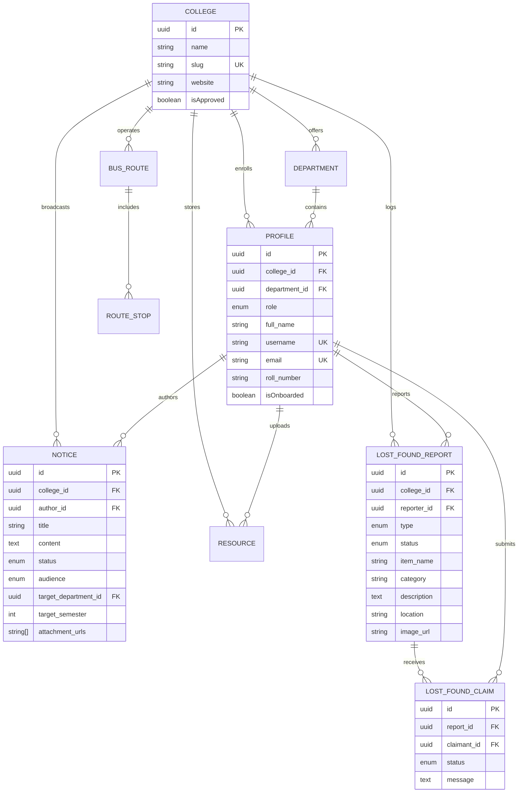

# CampusConnect (UniCon) — Architecture & System Design Document
*A Unified, Multi-Tenant Digital Campus Portal for Students, Faculty, and Administration*

---

## 1. Executive Summary & Problem Statement

### The Problem
College campuses struggle with fragmented communication channels. Important notices get lost in noisy WhatsApp groups, academic resources (notes, past exam papers) are scattered across Google Drives, transport schedules are manually managed, and lost-and-found items rely on physical bulletin boards or informal word-of-mouth.

### The Solution
**CampusConnect** is a centralized, multi-tenant campus operating platform designed as an offline-capable Progressive Web Application (PWA). It provides verified identity management, segmented academic circulars, digital resource repositories, lost-and-found resolution workflows, and real-time transit schedule tracking.

---

## 2. Technology Stack

### Frontend & Client Tier
* **Framework:** Next.js 16 (App Router) + React 19
  * Server Components (RSC) for initial page loads and SEO.
  * Client Components for rich interactivity, real-time filters, and dynamic updates.
* **Styling & UI Primitives:** 
  * Tailwind CSS v4 with modern theme variables (Dark / Light / System).
  * Radix UI primitives (Dialogs, Accordions, Dropdown Menus, Tabs, Toasts, Tooltips).
  * Lucide React icon suite.
* **Client State & Server Cache:**
  * **TanStack React Query v5:** Caching, optimistic UI mutations, and background re-fetching.
  * **Zustand v5:** Lightweight global client state (session context, sidebar navigation state, active modal toggles).
* **Progressive Web App (PWA):**
  * Web App Manifest (`manifest.ts`) and Service Worker integration.
  * Custom offline fallback view (`/offline`) for low-connectivity campus environments.
  * QR Code utilities (`qrcode`) for physical-to-digital campus touchpoints.

### Backend & API Tier
* **Routing & Runtimes:** Next.js Route Handlers (`/app/api/...`) running on Node.js and Edge runtimes.
* **Request Validation:** Zod v4 schemas enforcing strict compile-time and runtime type checks on all request payloads.
* **Authentication & Authorization:**
  * Supabase Auth (`@supabase/ssr`, `@supabase/supabase-js`) session management.
  * Google OAuth 2.0 (`@react-oauth/google`, `google-auth-library`).
  * Custom OTP verification pipeline using Nodemailer and Resend for campus email domains.
  * Next.js Middleware (`src/middleware.ts`) enforcing role-based route security.

### Data & Storage Tier
* **Database Engine:** PostgreSQL (Multi-tenant relational structure).
* **Object-Relational Mapping (ORM):** Drizzle ORM + Drizzle Kit
  * Strict type generation, clean migration files, and minimal runtime overhead compared to heavy ORMs.
* **Blob & Asset Storage:** Vercel Blob Storage / Supabase Storage (PDF study materials, PYQ papers, report photos, avatars).

### Quality Assurance & DevOps
* **Testing:** Playwright E2E testing with parallel desktop Chromium and mobile Chrome emulation profiles.
* **Build Engine:** Next.js Turbopack (`next dev --turbopack`).
* **Language Standard:** TypeScript 5 (Strict type checking enabled end-to-end).

---

## 3. High-Level System Architecture

```
                               +-------------------------------------+
                               |     Client Application (PWA)        |
                               | Next.js 16 + React 19 + Radix UI    |
                               | (Desktop, Mobile, Tablet Responsive)|
                               +------------------+------------------+
                                                  |
                                                  | HTTPS / WSS
                                                  v
                               +-------------------------------------+
                               |       Next.js Middleware Guard      |
                               |   - Session Validation              |
                               |   - Multi-tenant Subdomain/Slug     |
                               |   - Role-Based Access Control (RBAC)|
                               +---------+-----------------+---------+
                                         |                 |
                       +-----------------+                 +-----------------+
                       v                                                     v
          +-------------------------+                               +------------------------+
          | App Space: `/(app)`     |                               | Admin Space: `/(admin)`|
          | - Home & Campus Feed    |                               | - Student Verification |
          | - Targeted Notices      |                               | - Notice Publishing    |
          | - Academic Notes & PYQs |                               | - Transit Management   |
          | - Lost & Found Portal   |                               | - Campus Diagnostics   |
          | - Transit Tracking      |                               +-----------+------------+
          +------------+------------+                                           |
                       |                                                        |
                       +-------------------+------------------------------------+
                                           |
                                           v
                        +------------------------------------+
                        |       Next.js API & Server Actions |
                        |    (Zod-validated Request Handlers)|
                        +----+------------------+----------+-+
                             |                  |          |
              +--------------+                  |          +--------------+
              v                                 v                         v
     +-----------------+              +-------------------+     +------------------+
     |   Drizzle ORM   |              | External Services |     | Object Storage   |
     | Type-safe Query |              | - Resend / Mailer |     | - Vercel Blob    |
     |   Generation    |              | - Google OAuth    |     |   (PDFs, Images) |
     +--------+--------+              +-------------------+     +------------------+
              |
              v
     +----------------------------------------------------+
     |                PostgreSQL Database                 |
     | - Multi-tenant isolation by `college_id`           |
     | - Roles: student, faculty, admin, transport_admin  |
     | - Relations: notices, notes, pyqs, routes, claims  |
     +----------------------------------------------------+
```

---

## 4. Database Schema & Multi-Tenancy Design

Every core entity contains a `college_id` foreign key referencing the `colleges` table, providing clean tenant isolation across participating educational institutions.

### Core Entities & Relationships



---

## 5. Core Subsystem Workflows

### 5.1 Smart Notice Targeting Engine
Instead of flooding the entire student body with generic announcements, the circular broadcast engine uses scoped delivery filters:
* `all`: Whole institution broadcast.
* `department`: Targeted to a specific branch (e.g., Computer Science, Civil Engineering).
* `semester`: Batch-specific (e.g., Semester 6 students across branches).
* `department_semester`: Micro-targeted (e.g., Mechanical Engineering Semester 4).

### 5.2 Lost & Found Verification Loop
```
[Reporter] Submits Item (Lost/Found) + Details + Photo
        │
        ▼
Item appears in Campus Feed (Status: `active`)
        │
        ▼
[Claimant] Discovers item and files Claim with Proof of Ownership
        │
        ▼
Claim status set to `pending`
        │
        ▼
[Reporter] Reviews Claim Details
       ├── Rejected ──► Status: `rejected` (Item stays `active`)
       └── Approved ──► Status: `accepted`
                             │
                             ▼
                    Item status: `claimed`
                    Handover details unlocked for claimant
```

### 5.3 Academic Resources Repository (Notes & PYQs)
* Upload requests generate direct presigned storage paths via `@vercel/blob` to avoid server CPU/memory bottlenecks.
* Documents are categorized by Subject Code, Semester, Exam Category (`internal`, `mid_semester`, `end_semester`, `supplementary`), and Year.
* Includes file metadata storage (file size, mime type, download counters).

---

## 6. Security, Resilience & Scalability Measures

1. **Role-Based Access Control (RBAC):**
   * Pre-route inspection through Next.js middleware guards sensitive administrative paths (`/admin/*`) while keeping public and student spaces (`/(app)/*`) accessible.
2. **Multi-Tenancy Guardrails:**
   * Compound unique indexes on `(college_id, roll_number)` and scoped search queries ensure no student record overlap between different universities.
3. **PWA Offline Resilience:**
   * Critical app shell assets and basic cached responses remain functional even under poor cellular connectivity on remote campus grounds.
4. **Data Validation Integrity:**
   * Every incoming request parameter and body is validated with strict Zod parsing before reaching Drizzle query executors.

---

## 7. Hackathon Evaluation Rubric Alignment

| Criteria | CampusConnect Solution |
| :--- | :--- |
| **Innovation & Utility** | Consolidates disparate, noisy campus workflows into an elegant, role-governed single pane of glass. |
| **Technical Execution** | Cutting-edge 2026 web stack: Next.js 16 App Router, React 19, Drizzle ORM, Zod, and Playwright automated tests. |
| **Scalability Potential** | Multi-tenant schema from day zero; an entire university network can be provisioned simply by inserting a tenant record. |
| **User Experience** | Fast PWA design with mobile-first layouts, accessible Radix components, dark mode support, and offline graceful degradation. |
